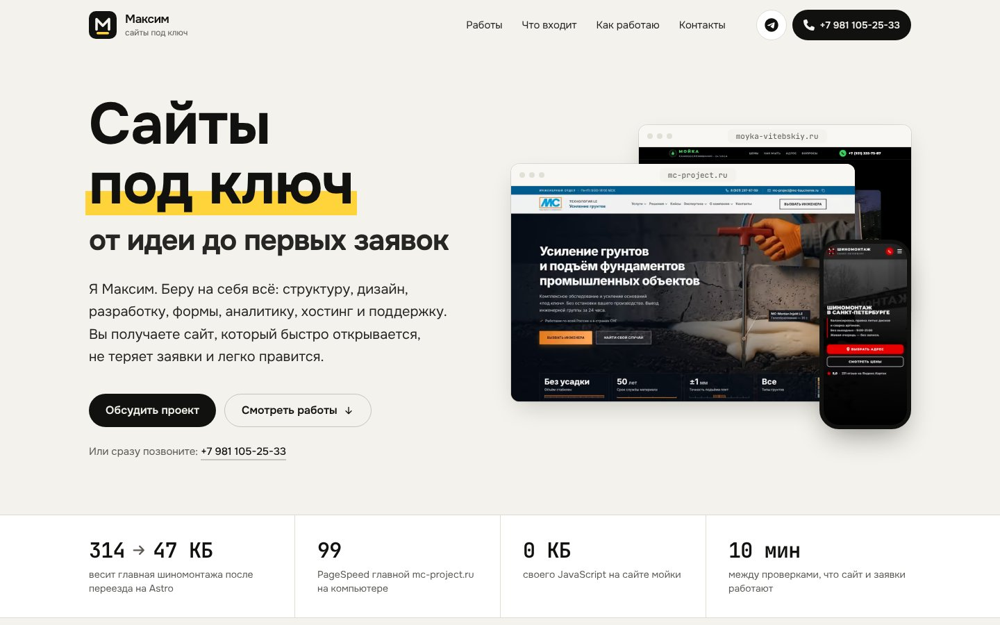
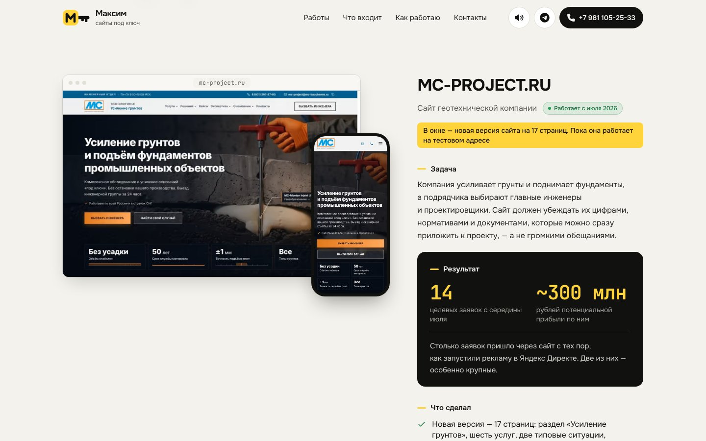
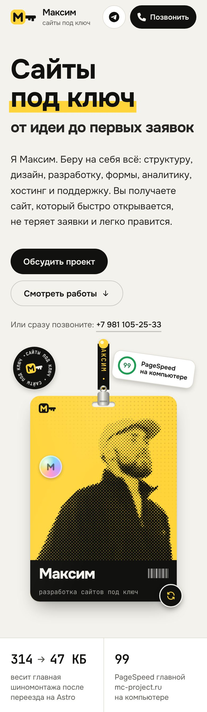
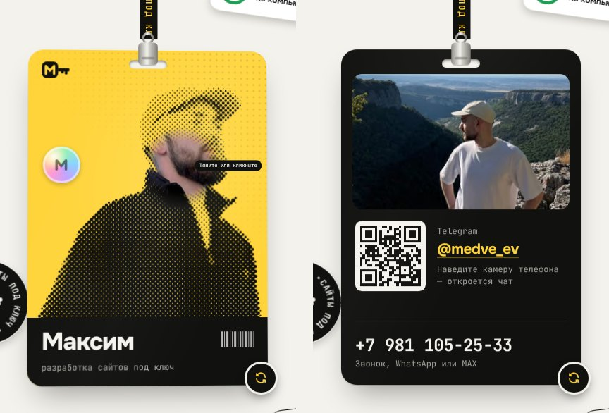

# Максим — разработка сайтов под ключ

Сайт-визитка с портфолио: кто я, какие сайты сделал, что входит в работу «под ключ» и как со мной связаться. На первом экране — визитка на ленте: её можно схватить, бросить и перевернуть. Работы показаны в «живых окнах»: сайт в рамке браузера и телефона сам листается, как запись экрана, а колёсиком мыши его можно прокрутить, как настоящий.



## Технологии

- **Astro 7**: статическая генерация, одна страница
- **GSAP 3** с ScrollTrigger и SplitText: анимации прокрутки, «живые окна», наведение
- **Tailwind CSS 4**: тема в `@theme` прямо в `src/styles/global.css`, без конфиг-файла
- **TypeScript**: данные и скрипты, `astro check` проходит без ошибок
- **Canvas и WebAudio**: точки полутонового портрета и звуки нажатий — без библиотек и звуковых файлов
- **Шрифты**: Onest и JetBrains Mono, self-host из `@fontsource-variable`, ни одного запроса к Google или CDN
- **Vercel**: статический хостинг, выкладка из `main` сама

## Что внутри

| Блок | Реализация |
|------|-----------|
| Первый экран | Заголовок поднимается из-под маски на CSS, сразу при первой отрисовке. Справа — визитка на ленте (подробности ниже) и наклейки, которые можно отклеить и бросить |
| Ленты | Две ленты крест-накрест с тем, что входит в «под ключ». Едут навстречу, от прокрутки разгоняются, меняют направление вслед за ней и кренятся на скорости |
| Работы | Четыре кейса и два демо. Окно «встаёт» из наклона вслед за прокруткой, как экран открываемого ноутбука; галочки прорисовываются, метрики досчитывают |
| Подход | Абзац крупно: слова заливаются по очереди из контура, будто текст читают вслух, маркер дорисовывается под ключевыми словами |
| Что входит | Девять услуг. На широком экране секция закрепляется, и лента карточек едет вбок, пока страница листается вниз |
| Как работаю | Линия этапов дорисовывается прокруткой, кружки загораются, когда она до них дошла |
| Контакты | Тёмный блок раскрывается из скруглённой карточки во всю ширину. Телефон и WhatsApp на один номер, Telegram, MAX; номер можно скопировать в одно нажатие |
| Подвал | Имя во всю ширину: буквы поднимаются при появлении и набирают вес рядом с курсором — у Onest вариативная насыщенность |

Кнопки тянутся за курсором («магнит») и заливаются при наведении, заголовки секций проявляются по словам, по нижнему краю шапки растёт полоса прочитанного. Рядом с курсором — подсказка, что здесь можно сделать: «тяните», «колёсико — листать сайт», «отклейте». У каждого нажатия свой короткий звук; кнопка в шапке (на телефоне — в подвале) выключает звук, выбор запоминается.

Знак — ключ, у которого головка — жёлтая плашка с «М»: «сайты под ключ». При наведении ключ поворачивается в замке.

<p align="center">
  
  
</p>

## Визитка



`src/components/Badge.astro` + `src/scripts/badge.ts`, `portrait.ts`, `stickers.ts`.

- Лента — цепочка точек, визитка — жёсткий отрезок от крепления до нижнего края. Всё считается интегрированием Верле с ограничениями длины, как верёвки в играх: визитку можно схватить мышью и бросить, она качается и крутится. Бросок вбок раскручивает её, и после оборотов она встаёт той стороной, к которой ближе. Брошенная на текст, визитка остаётся поверх него — её можно схватить снова. На компьютере прокрутка слегка относит визитку в сторону, как ветер (скорость прокрутки сглажена, чтобы визитка не дрожала); на телефоне прокрутка её не трогает.
- Клик или кнопка в углу переворачивают визитку. На обороте — фото, Telegram с QR-кодом (рисуется при сборке, без библиотек на странице) и телефон. Скрытая сторона выключена из фокуса и для скринридера (`inert`).
- На телефоне визитку переворачивают касанием и крутят свайпом вбок, вертикальный свайп листает страницу как обычно.
- Портрет — полутоновая «печать» из 2 744 точек. Сначала это SVG-картинка; если есть мышь, скрипт читает из неё те же точки и рисует их на canvas в полной плотности экрана: под курсором точки пружинками разбегаются, а в «линзе» проступает цветное фото. На телефоне портрет так и остаётся чёткой SVG-картинкой, а цветное фото не загружается.
- Под курсором визитка наклоняется, по ней бежит блик, голограмма переливается.
- Когда всё замерло или визитка ушла с экрана, расчёт останавливается.
- Без скрипта и при «уменьшить движение» визитка просто висит; перевернуть её кнопкой можно и тогда.

### Как заменить фото

```bash
python3 -m venv .venv-avatar && .venv-avatar/bin/pip install "rembg[cpu]" pillow   # один раз
.venv-avatar/bin/python tools/avatar.py лицо.jpg горы.jpg   # вырезает фон, кладёт в src/assets/avatar/
node tools/halftone.mjs                                      # полутоновый портрет из нового фото
node tools/brand.mjs                                         # фавиконки и картинка для соцсетей
```

## «Живые окна»

`src/components/LiveWindow.astro` + `src/scripts/live.ts`.

- Сразу видна картинка первого экрана (постер). Длинный кадр страницы скрипт подгружает, когда окно подходит к экрану (`IntersectionObserver`, за 400 px), и листает GSAP-таймлайном с паузами на секциях.
- Шапка сайта в окне ведёт себя как настоящая липкая: поверх листающегося кадра лежит её полоса в прокрученном состоянии.
- Несколько кадров в одном окне — переход по страницам: адрес в строке меняется вместе с кадром.
- Окно играет, только пока видно. Под курсором автопрокрутка встаёт, и колёсико листает сайт в окне один к одному, как настоящий. Дойдя до края, колёсико снова листает страницу — но не в том же жесте, иначе инерция тачпада проскакивала бы окно насквозь. Курсор ушёл — «видео» едет дальше с ближайшей остановки.
- Кнопка паузы в строке адреса останавливает окна своей группы (WCAG 2.2.2). При «уменьшить движение» и без JavaScript окна остаются постерами.

### Как обновить кадры

Кадры снимаются с живых сайтов скриптом, руками ничего править не нужно:

```bash
npm i --no-save playwright && npx playwright install chromium   # один раз
node tools/capture-live.mjs                  # все кадры из tools/live-jobs.json
node tools/capture-live.mjs moyka-desktop    # или только нужные
node tools/live-post.mjs                     # постеры, полосы шапок, остановки
```

Задания — в `tools/live-jobs.json`: адрес, страница, устройство, высота кадра. Результат — `src/assets/live/` и `src/data/live.json` (высота шапки и остановки «видео» — края секций). Какие кадры в каком окне, задаётся в `src/data/works.ts` полем `screens`.

Страницы с картами и чужими iframe (виджеты отзывов Яндекс Карт) снимаются склейкой из снимков экрана — `"mode": "stitch"` в задании: в полностраничном снимке Chromium оставляет их чёрными. Счётчики (Метрика, Callibri) при съёмке не грузятся, чтобы не портить статистику заказчиков.

Окно mc-project показывает новую версию сайта с тестового адреса — четыре страницы подряд.

## Где что править

- `src/data/site.ts`: имя, телефон, Telegram, MAX, WhatsApp, пункты меню
- `src/data/works.ts`: кейсы и демо. Каждая цифра там взята из README и аудитов самих проектов, источники перечислены в шапке файла
- `src/data/services.ts`: услуги и шаги работы
- `src/components/Badge.astro`: надписи на визитке и наклейках; фото — `src/assets/avatar/` (см. «Как заменить фото»)

Для текстов из `data/` работает `src/lib/typo.ts`: он привязывает короткие предлоги к следующему слову и не даёт словам через дефис («Санкт-Петербург», «152-ФЗ») разорваться на конце строки.

## Производительность и доступность

Lighthouse, локальная сборка со сжатием brotli, по три прогона (24–25.10.2026):

| | Performance | Accessibility | Best Practices | SEO |
|---|---|---|---|---|
| Телефон | 97–100 | 100 | 100 | 100 |
| Компьютер | 100 | 100 | 100 | 100 |

- На телефоне: FCP 1,0–1,5 с, LCP 1,3–2,1 с, TBT 0–90 мс, CLS 0. Главный контент первого экрана — текст, он виден с первой отрисовки: анимации первого экрана двигают, но не прячут
- Сразу грузится только скрипт на 5 КБ — звук и копирование номера. GSAP и эффекты приезжают отдельными файлами после загрузки страницы, в свободное время и по частям, а настройка анимаций идёт задачами короче 50 мс
- Цветное фото для «линзы» и фото с оборота визитки грузятся после загрузки страницы: к первой отрисовке они не нужны
- Длинные кадры окон — AVIF под ширину окна
- axe-core: 0 нарушений на 390 и 1440 px, с анимациями и без. Весь текст — не мельче 12 px
- Всё, что проявляется при прокрутке, остаётся в порядке Tab: прячется только прозрачностью, а фокус проявляет блок сразу
- Учитывается `prefers-reduced-motion`; без JavaScript страница видна целиком

## Разработка

```bash
npm install
npm run dev      # http://localhost:4321
npm run build    # сборка в dist/
npm run preview  # посмотреть собранное
npm run check    # проверка типов
```

Требуется Node.js 22.12 или новее. Astro закреплён на ветке 7.3: 7.4.2 требует Node 22.23.4. Первая сборка нарезает кадры окон около двух минут, дальше они берутся из кэша. В режиме разработки кадры окон нарезаются по запросу, поэтому окна оживают с задержкой — проверять их удобнее на `npm run build && npm run preview`.

## Выкладка

Каждый пуш в `main` Vercel собирает и выкладывает сам. Адрес для canonical, `og:url` и sitemap берётся из `VERCEL_PROJECT_PRODUCTION_URL`: это свой домен, если он подключён, иначе `*.vercel.app`. Задать адрес вручную можно переменной `SITE_URL`.
